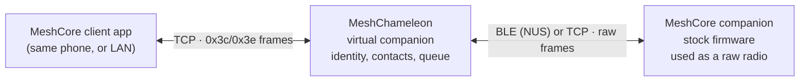

# Development notes

## Architecture and repository layout

MeshChameleon is a standalone reimplementation. It reuses/ports MIT-licensed
code from [`meshcore-open`](https://github.com/zjs81/meshcore-open) (framing,
protocol constants, crypto stack) and
[`openhop_core`](https://github.com/openhop-dev/openhop_core) (companion node
logic). See `ATTRIBUTION.md`.



MeshChameleon exposes a **TCP server** that speaks the MeshCore companion
protocol (the same wire format a client uses for a TCP/network companion). The
primary deployment runs the client on the same phone over `127.0.0.1`; the
listener binds all interfaces so a client on the local network can use the
phone's IP instead. It generates, stores, and uses its own Ed25519 MeshCore
identity on the phone and reports that identity in `SELF_INFO`/adverts. Behind
the scenes it connects to a real companion over **BLE (NUS)** or **TCP**,
treating that device as a **raw radio**: it transmits arbitrary MeshCore packets
with `CMD_SEND_RAW_PACKET` and receives every over-air frame via
`PUSH_CODE_LOG_RX_DATA`.

Repository layout:

```text
packages/
  mesh_protocol/    on-air packet codec + crypto + identity + shared models
  companion_server/ TCP listener + serial framing + command router (app-facing)
  mesh_node/        contacts/channels/messages/adverts/acks and mesh node logic
  device_link/      RadioLink SPI + TCP device client + device simulator
  test_support/     dev-only framed client, stream queue, and fake scheduler
app/                Flutter app: UI, foreground service, secure storage
app/integration_test/  opt-in hardware tests (see its README)
```

Inside `mesh_node/lib/src/`, `mesh_node.dart` is the companion facade and
lifecycle owner. Inbound packets are routed by `mesh_rx.dart`, outbound packet
construction lives in `message_sender.dart`, and `physical_radio.dart` owns the
serialised radio configuration/cache. Smaller collaborators own contacts,
advert paths, the inbound queue, request tags, ACKs, connections, flood scope,
raw transport, and state persistence. Keep protocol behavior changes in the
owning collaborator and add focused tests for that collaborator.

Durable mutations queue a read-modify-write function against the last published
`NodeState`, so concurrent commits cannot each start from the same stale
snapshot. Publication applies only the preference fields a candidate changed,
which keeps an unrelated radio readback from being reverted. `runtime_guard.dart`
owns the identity generation and the retired/powered-off/reset/swap/pause state
that gates semantic work.

Inside `companion_server/lib/src/`, `server.dart` owns the TCP listener, client
lifecycle, framing, timers, reply generation checks, and the push sink.
`command_dispatcher.dart` owns the declarative command table and the command
handlers, `push_codec.dart` holds the pure push/message byte encoders, and
`bridge.dart` is the host interface. Unimplemented bridge operations throw
`CompanionOperationError(errCodeUnsupportedCmd)`; only pure empty-state getters
(no contacts, no messages, default preferences) have working defaults. Stats
are returned as the typed `MeshStats` object. Unexpected handler failures answer
`ERR_BAD_STATE` and increment `internalErrors`; malformed input remains
`ERR_ILLEGAL_ARG`.

## Running an end-to-end test without hardware

The pure-Dart packages include a stock-companion simulator (`FakeDeviceLink`)
and a shared radio bus (`FakeRadioBus`). The highest-value end-to-end test is
`packages/mesh_node/test/integration_test.dart`: a framed TCP client (a stand-in
for `meshcore-cli` / `meshcore-open`) connects to the proxy's `CompanionServer`,
which drives a `MeshNode` over a simulated device link, against a peer node on
the same simulated bus.

Shared test plumbing lives in `packages/test_support/` (`FramedClient`,
`StreamQueue`, `FakeScheduler`). `CompanionServer` accepts injected one-shot and
periodic timer factories, so idle/heartbeat tests advance the fake clock instead
of sleeping on wall time.

Run everything:

```sh
./scripts/check.sh
```

The script uses `dart` and `flutter` from `PATH`; set `DART` / `FLUTTER` to
override them. It enforces `dart format` and runs the analysis/tests for every
package and the app. Pass `--no-tests` to run only the format and analysis
gates; CI uses it because the coverage step below runs the same suite once.

Coverage is a separate gate so local iteration stays fast:

```sh
./scripts/coverage.sh
```

It runs the same tests with coverage instrumentation and compares per-file line
coverage against `coverage_baseline.json`. A file may lose one covered line
without failing, because coverage attribution of a single line is not stable
between runs; a larger loss fails. Files that are new to the baseline must be at
least 80% covered. After an intentional coverage change, refresh the baseline
with `./scripts/coverage.sh --write-baseline` (and review the JSON diff before
committing it).

The same simulator is also reachable without writing a test: from the Linux
desktop app's **Simulated** tab, or from the headless CLI below.

If `meshcli` is installed, the optional external-client smoke test is:

```sh
cd packages/mesh_node
dart run tool/proxy_cli.dart --simulated --proxy-port 5099
# in another shell
meshcli -t 127.0.0.1 -p 5099 infos ver clock
```

The 1.18 signoff used `meshcore-cli v1.6.6` against this simulated proxy. It
reported firmware code 14 / `v1.18.0` and the virtual board. This is a client
handshake check, not radio or hardware validation.

## Hardware-in-the-loop tests

`app/integration_test/` contains the opt-in hardware harnesses (BLE and TCP
device links, RF send/receive, reboot/reconnect, battery, foreground service).
They are never part of `scripts/check.sh` and have no built-in device names,
hosts, or peer keys; pass them with `--dart-define`. See
`app/integration_test/README.md` for the test list, required defines, and
warnings about RF transmission and radio reboots. Reusable headless clients and
fault injectors live in `packages/companion_server/tool/` and
`packages/device_link/tool/`.

## Compatibility target and intentional differences

The virtual companion advertises MeshCore 1.18 (`DEVICE_INFO` fw code 14,
version `v1.18.0`) with the virtual board string, 350-contact/40-channel
capacities, 4 MiB virtual storage, the virtual identity/capabilities, and the
physical radio's repeat byte and real max TX/RF values. The following
differences from a bare physical companion are intentional and are not bugs:

- No automatic physical state writes: virtual preferences, contacts, channels,
  paths, queues, malformed inputs and storage errors never silently reconfigure
  the radio.
- Physical setters await device confirmation. `SET_RADIO_PARAMS` saves firmware
  prefs; saved values are not the live channel until the device reboots. Read
  back SELF_INFO and treat `saved-only` state separately from active RF.
- The virtual clock is host-derived. SET_DEVICE_TIME and timezone changes never
  touch the phone/radio RTC.
- Only a minimal telemetry surface is synthesized: fresh physical voltage plus
  virtual GPS when permitted. No physical GPS, MCU temperature, environment
  sensors, or sensor-node subscription server is fabricated.
- PIN and factory reset remain disabled; there is no remote or binary reset
  alias. The only reset is the explicit app-only virtual reset.
- Remote physical administration is denied. A remote CLI peer can run virtual
  commands only when its contact has flag `0x10`.
- Decoders reject truncated/oversized/unsafe values rather than reproducing
  `atoi`/`atof` acceptance. Persistence failures return honest errors.

Other deliberate limits: no iOS/USB transport work, no virtual repeater
routing/forwarding, no mandatory authentication redesign, and no sensor-node
implementation. Routine dependency updates are handled by Renovate; do not
bundle them into unrelated changes. Pre-0.1.0 single-identity development data
is outside the migration baseline; see
[Persistence versions and migrations](#persistence-versions-and-migrations).

## Multi-identity runtime

All enabled catalog identities are started as live `MeshNode` runtimes while a
device is connected. `SharedRadioHub` owns the single raw-RX registration and
fans frames to every runtime; `LocalMeshRouter` mirrors every outbound packet to
the other live identities after the RF dispatch succeeds. The active identity's
node is the only one bound to `CompanionServer`; switching calls
`server.switchBridge()` to disconnect the old client and serve the new
`SELF_INFO` without rebinding the TCP listener.

Storage layout:

```text
<app-support>/identities/index.json          catalog (public-key/name caches only)
<app-support>/identities/<id>/node_state.json contacts/channels/queue/prefs
secure storage: meshcore_identity_v2/<id>     64-byte expanded key
```

Rules worth preserving:

- Inactive identities still receive, decrypt, ACK, and queue traffic, but never
  send unsolicited adverts. Each identity keeps the stock 16-message queue:
  when full, the oldest channel message is evicted; if none exists, the new
  message is dropped. A pre-0.1.0 state file with a larger queue is trimmed to
  the newest 16 messages on load.
- Disabled identities keep their key, state, and queue but have no live runtime,
  so they cannot receive, ACK, or queue new traffic until re-enabled. The active
  identity must stay enabled; a catalog whose active record is disabled is
  repaired to an enabled identity at startup.
- `active_id` must reference a record; a missing active selection is repaired to
  a readable identity at startup.
- Public keys are unique across records. A protocol key import updates the
  active record in place, keeps its name/state, and is rejected if another
  identity or the attached radio already uses that key.
- Node state is the source of truth for the name; `SET_ADVERT_NAME` and the CLI
  `set name` repair the catalog cache. The MeshChameleon UI only writes a name
  when creating an identity.
- The local mirror uses the exact outbound bytes and a peer-origin flag, so a
  direct path may remain without blocking local delivery. Mirror copies emit no
  raw-RX push and add no RF airtime; they are deduplicated like RF duplicates.
- The attached radio's own public key is kept internal and rejects direct sends.
  It is never exposed as a contact or virtual identity.
- State directories not referenced by the loaded catalog are logged and kept,
  never auto-deleted: after recovery from a stale backup they can be the only
  remaining copy of a newer identity's contacts, channels, and messages.
- `--identity-file` headless proxy runs remain single-identity; the feature
  targets the app.

## Persistence versions and migrations

0.1.0 is the initial release baseline for all persisted data. Every file below
carries an explicit schema version:

| Data | Location | Version | Constant |
|---|---|---|---|
| Identity catalog | `<app-support>/identities/index.json` | 2 | `identityIndexVersion` |
| Per-identity node state | `<app-support>/identities/<id>/node_state.json` | 2 | `nodeStateSchemaVersion` |
| Saved network targets | `<app-support>/network_connections.json` | 1 | `networkConnectionHistoryVersion` |
| Last session | `<app-support>/session.json` | 2 | `sessionConfigVersion` |
| Secure identity slots | `meshcore_identity_v2/<id>` | 2 (namespace) | `IdentityStore` |

Rules for any change after 0.1.0:

- Bump the affected schema version and keep reading the previous released
  version through an explicit migration path.
- Identity catalog v1 records have no `enabled` field; they are read as enabled
  and written back as v2 on the first load.
- Add fixtures for each released on-disk layout and test the migration, not only
  the new format.
- Node state with no `version` field is read as v1. A state file declaring a
  newer version raises `NodeStateVersionException`; the file is kept in place
  and the affected identity is surfaced as unavailable instead of being reset.
- Node state v2 no longer writes the unused `client_repeat` preference. An
  existing file that contains it still loads; the field is ignored because the
  live repeat byte comes from the physical device capabilities.
- Session schema v2 adds `recoveryPending` and `recoveryServeProxy` so a parked
  device recovery survives process death. Version 1 (and a versionless file)
  reads both as `false`; writes always use v2. `recoveryServeProxy` records
  whether the proxy was running when the session parked, so recovery never
  restarts a proxy the user stopped themselves.
- `session.json` and `network_connections.json` are read through
  `JsonDocumentStore`. A missing file is first-run data. A corrupt, unreadable,
  or newer-version file raises `JsonDocumentException` /
  `JsonDocumentVersionException`; corrupt and newer-version files are
  quarantined as `<name>.quarantine-<timestamp>` before any save, and session/
  history startup logs the error and continues with defaults.
- Never discard a user's identity catalog or node state because the version is
  unknown. Surface a recovery error instead of silently creating a fresh
  identity.
- Update this table when a version or storage location changes. Pre-0.1.0
  development layouts (single-identity `meshcore_identity_v1`, root
  `node_state.json`) are outside the baseline and are not migrated. The one
  exception is a versionless `session.json`: its fields are unchanged, so it is
  read as version 1.

## Backup files

The app can export the catalog, every identity key, per-identity node state,
the saved session, and saved network connections as a passphrase-encrypted
`.mcbackup` file (`app/lib/services/backup_codec.dart`,
`app/lib/services/backup_service.dart`). The envelope is versioned; bump
`backupFormatVersion` only for incompatible layout changes, and keep refusing
unknown future versions. Restores stage the new catalog, rename the current
identity directory to `identities.recovery-<stamp>`, and roll back on failure.
Before the swap, restore writes `restore-in-progress.json` and snapshots the old
keys in `meshcore_identity_restore_v1/<id>` secure slots. If the process dies
mid-restore, the next launch rolls the directory and keys back; a completed
marker is cleaned up without rolling back. Do not log passphrases, keys, or
decrypted payloads.

## Co-client and raw-modem limitations

The proxy requires the physical companion to behave as an exclusive raw-radio
modem. A second app/BLE/TCP client talking to the same stock companion can
receive or consume replies concurrently, and the firmware broadcasts CLI replies
to every enabled interface. The proxy cannot serialize an external client. Do not
run another configuration client against the same radio during a session.

The device link correlates replies only by response code, not by a request id.
A query timeout therefore drops the link instead of leaving it open, so a late
`DEVICE_INFO`/`CLI_REPLY` cannot be mistaken for the next request's reply; the
app reconnects through its normal link watcher.

Raw transmits use a separate, longer timeout (30 s). Stock firmware acknowledges
`SEND_RAW_PACKET` as soon as the packet is queued, but some companion
implementations wait for the local transmission (including duty-cycle or LBT
deferral), so a 5 s request timeout can expire while the packet is still going
out. A timed-out transmit does not drop the link: its late `OK`/`ERR` is
quarantined, and the next request waits up to 5 s for that reply to arrive or
expire before it is sent. This keeps a slow radio from turning a successful send
into a session outage and a duplicate client retry.

Device-link recovery has two stages. A dropped device first enters
`reconnecting`: the link is retried with the normal connect backoff for three
cycles while the proxy and live identities stay up, so a short drop does not
evict the MeshCore client. If every cycle fails, the session parks in `waiting`:
the proxy stops exactly once (the client sees the disconnect) and the live
runtimes stop, but the saved target and the foreground service remain. A BLE
session arms a FlutterBluePlus `autoConnect` request; a TCP session retries after
30 s, 1 min, 2 min, 5 min, 10 min, then every 15 min. When the radio returns the
runtimes start from persisted node state and the proxy restarts only if it was
running when the session parked. Cancel, Disconnect, and physical power-off all
stop the service and clear the parked state.

Recovery intent is persisted in session schema v2, so a process death during
`waiting` re-arms on the next launch even when **Resume on launch** is off. A
cold-start resume that fails (no prior parked session) returns to idle instead of
parking; only an established session parks. The reference MeshCore TCP client
does not auto-reconnect: after the proxy restarts the client must reconnect.
BLE `autoConnect`, long-running foreground-service survival, and TCP background
retries remain **PENDING** hardware validation.

Direct-route semantic delivery requires a consumed zero-hop route; flooded or
still-in-transit packets are raw-logged but not executed locally. This is not a
repeater: no packet forwarding is implemented.

## Virtual storage and quota

Each identity has its own 4 MiB virtual partition: contacts (350), channels (40),
queued messages, advert blobs/path cache, and sensor preferences are enforced
before publish. Quota failures are reported as storage/table-full errors; the app
does not delete broad directories or physical radio state to recover. See
`SECURITY.md` for at-rest storage.

## Linux desktop and headless proxy

Two hardware-free targets share the pure-Dart core:

- **Linux desktop** (`app/linux/`) — the real UI. BLE is hidden off mobile
  because there is no desktop `flutter_blue_plus` implementation; the
  **Simulated** tab drives the real `MeshNode` and `CompanionServer` from an
  in-memory `FakeDeviceLink`.
- **Headless CLI** (`packages/mesh_node/tool/proxy_cli.dart`) — no Flutter, no
  GUI, TCP device link only.

Build dependencies on Arch (GTK3, libsecret, and pkg-config are usually already
present):

```sh
sudo pacman -S --needed clang cmake ninja
```

Run the desktop app:

```sh
cd app
flutter run -d linux
```

Run the headless proxy:

```sh
cd packages/mesh_node
dart run tool/proxy_cli.dart --simulated
dart run tool/proxy_cli.dart --device <companion-host>:5000
```

Other options: `--proxy-port` (default 5000, `0` picks a free port),
`--identity-file`, and `--state-dir` (persist contacts/channels/queue). Without
`--identity-file` the identity is regenerated each run, so every launch presents
a new `SELF_INFO` public key.

`--identity-file` writes the proxy's private identity as **plaintext hex at mode
0600**. Use it only for development; the phone app's Keystore-backed storage is
the real model (see `SECURITY.md`).

Desktop builds have no BLE device link and no background service — desktop has
no process suspension to defend against, so the link simply stays up while the
app runs. None of this is hardware-validated.

## Connecting a real client

Start the proxy (port defaults to 5000), then point a client at the phone's IP:

```sh
meshcli -t <phone-ip> -p 5000 infos ver clock contacts get_channels adv
```

`CLI_OK` for `infos` means the proxy's `SELF_INFO` (identity + radio params) is
correct.

## Radio units

The companion protocol is inconsistent: `SELF_INFO` and `CMD_SET_RADIO_PARAMS`
encode frequency in **kHz** (915000) and bandwidth in **Hz** (250000). The Dart
core normalises `RadioParams.frequencyHz` to true Hz and converts at the wire
boundary.

## Radio changes and device reboot

`CMD_SET_RADIO_PARAMS (11)` **saves** the new radio prefs but does not retune the
live radio until the device reboots; `SELF_INFO` reports the saved prefs, so it
can read back the new values while the radio is still on the old channel. A real
client therefore sends `CMD_REBOOT (19)` after changing radio settings.

`CMD_REBOOT` matches the firmware: it reboots the **device** (the firmware reboots
the hardware so saved prefs take effect). The proxy does that on
`RadioLink.reboot()` (a fire-and-forget `[19]["reboot"]` frame — the firmware
reboots without replying) in addition to its soft node-engine restart. The device
link will drop and the app reconnects it.

## Flood scope (regions)

`CMD_SET_FLOOD_SCOPE (54)` sets a send-scope override for flooded packets
(`[54, 0, key(16)]` sets it, `[54, 0]` resets it, and `[54, 1]` forces unscoped
flooding on fw v12+). `CMD_GET/SET_DEFAULT_FLOOD_SCOPE (64/63)` manage a
persisted default region scope. When a scope is active, flooded
adverts/direct/group sends are emitted as **transport-flooded** packets carrying
a 16-bit code: the first two bytes (LE) of
`HMAC-SHA256(scopeKey, [payloadType, ...payload])`, with `0x0000`/`0xFFFF`
reserved, matching the firmware's `TransportKey::calcTransportCode`. With no
scope set, packets are byte-for-byte unchanged. This is not hardware-validated.

## Binary and anonymous requests

`CMD_SEND_BINARY_REQ (50)` and `CMD_SEND_ANON_REQ (57)` both answer `SENT`
(`[6][flood][tag(4)][timeout(4)]`) with the request's real tag, and deliver the
reply as `PUSH_CODE_BINARY_RESPONSE`:
`[0x8C][reserved(1)][tag(4)][payload]` — the firmware's `onContactResponse`
layout, matched by `meshcore-open` (e.g. the region management and neighbors
screens). An anonymous request for an unknown target registers a zero-hop
contact first, mirroring the firmware. As with telemetry, the decrypted payload
is AES-block-padded, so a trailing partial block may be zero-filled.

## CLI commands and self telemetry

`CMD_RUN_CLI_COMMAND (66)` (fw v14+) returns the device's CLI text as
`RESP_CODE_CLI_REPLY (29)` (`[29][utf8 text]`), matching the firmware; on older
firmware the proxy answers `ERR`. `CMD_SEND_TELEMETRY_REQ (39)` with a 3-byte
payload is the `'self'` telemetry request (firmware `len == 4`): the proxy
answers with its own CayenneLPP telemetry (battery voltage on the self channel)
as `PUSH_CODE_TELEMETRY_RESPONSE (0x8B)`.

Flooded request replies (login/status/telemetry/binary) can take **~15-25 s** to
arrive, because the repeater has to complete/return the path.

## Contact sharing

Each `Contact` stores the last raw advert packet it was learned from
(`rawAdvert`), persisted with the contact. `CMD_EXPORT_CONTACT (17)` returns that
blob — or a freshly built self advert when no public key is supplied — which is
the `meshcore://<hex>` contact URI form. `CMD_SHARE_CONTACT (16)` re-transmits a
contact's saved advert zero-hop so nearby nodes can learn it, and
`CMD_IMPORT_CONTACT (18)` parses a blob and processes it as if it had just been
received (flood). Not hardware-validated.

## Allowed repeat frequencies

`CMD_GET_ALLOWED_REPEAT_FREQ (60)` relays the connected device's regulatory
ranges by forwarding command 60 to the device link
(`RadioLink.getAllowedRepeatFreq`) and returning the raw
`[lower(4)][upper(4)]...` bytes under `RESP_ALLOWED_REPEAT_FREQ (26)`.

## Raw data

`CMD_SEND_RAW_DATA (25)` takes `[path_len][path][payload]` and transmits a
`PAYLOAD_TYPE_RAW_CUSTOM` packet directly along the decoded path (minimum
4-byte payload), matching the firmware. Flood is not supported (a reserved
hash-width encoding is rejected with `ERR_CODE_UNSUPPORTED_CMD`), and the path
is used verbatim without adding an ACK.

`CMD_SEND_RAW_PACKET (65)` takes `[priority][packet bytes]`, parses the packet
and transmits it verbatim — the route type and path are whatever the packet's
header encodes, so no scope or route rewriting is applied. The supplied priority
byte is passed through to the device transport.

## Disabled and key commands

`SET_DEVICE_PIN (37)` and `FACTORY_RESET (51)` receive the one-byte
`RESP_CODE_DISABLED (15)` response and never alter the device or app state.

`EXPORT_PRIVATE_KEY (23)` and `IMPORT_PRIVATE_KEY (24)` operate only on the
**virtual** identity. Export returns the active 64-byte key; import validates the
derived prefix and symmetric non-zero ECDH with the upstream test keypair, then
persists before switching. Neither sends key material to or reads it from the
physical companion. This is a deliberate local protocol operation with no extra
app confirmation, so treat the TCP/BLE endpoint as trusted.

## Identity forms and signing

A fresh identity is generated from a 32-byte seed. The 64-byte MeshCore form
(`[scalar(32)][prefix(32)]`) is the expanded Ed25519 key: it is what the app
persists and what the app-facing TCP companion endpoint exports. **Both forms can sign**
— `LocalIdentity` signs seed identities via `cryptography` and 64-byte identities
directly from the expanded key (`CryptoUtils.ed25519SignFromExpanded`, RFC 8032),
so no seed recovery is needed.

## Local endpoint and credential exposure

The app-facing companion endpoint has **no authentication or transport
encryption**. It listens on all interfaces, so any app on the phone can reach
`127.0.0.1:<port>` and devices on the local network can reach the phone's IP.
Anything that can reach it can read the virtual identity, import a replacement,
add/remove contacts, send mesh traffic, run virtual CLI commands, and—on
physical firmware v14+—run the allowlisted physical CLI subset. That subset
includes WiFi SSID/password reads and radio preference changes. WiFi passwords
are forwarded as CLI text and are never logged, cached, or truncated by the
proxy, but they are still exposed to a trusted client and to the radio firmware.
Use the endpoint only on a trusted phone and network; do not expose it to the
internet.

## Hardware validation

Simulator/byte-level conformance does not prove hardware behavior. BLE/TCP
transports, RF immediate-vs-reboot application, WiFi reconfiguration, client
repeat, independent physical DMs, remote CLI, sensor telemetry, Android
background/Doze survival, and the `flutter_secure_storage` v9→v10 key migration
remain a separate **PENDING** hardware matrix. No live adverts/TX or firmware
flashing is part of the default test gate.

## Identity storage

Each identity key is kept in its own Android Keystore-backed secure-storage
slot (`meshcore_identity_v2/<id>`). `flutter_secure_storage` v10 uses AES-256-GCM
values with RSA-OAEP key wrapping and migrates v9
`EncryptedSharedPreferences` entries on first access. Android backup is disabled
(`allowBackup="false"`). Pre-0.1.0 single-identity data
(`meshcore_identity_v1`, root-level `node_state.json`) is outside the migration
baseline and is deliberately ignored. See `SECURITY.md` for the full model and
its caveats.

## Background execution (Android)

The proxy keeps the device link and the app-facing `ServerSocket` alive under a
`flutter_foreground_task` service (M0 shape A: the engine runs in the main
isolate). `ForegroundService` is injected into `AppState`, so tests can exercise
the start/update/stop lifecycle without an Android platform. Two home-screen
controls make that reliable:

- **Battery optimization** — shows the current status and opens the system
  battery-optimization settings; the status is re-checked whenever the app
  returns to the foreground. MeshChameleon does not request the restricted
  `REQUEST_IGNORE_BATTERY_OPTIMIZATIONS` permission or show a one-tap exemption
  prompt. Without an unrestricted setting, Doze and OEM battery managers can
  suspend the background link.
- **Resume on launch** — when enabled, the app remembers the last device target
  (TCP host/port or BLE remote id) plus the proxy port in
  `<app-support>/session.json` (`SessionStore`), and reconnects the device and
  restarts the proxy on the next launch. A persisted `recoveryPending` session
  takes precedence: recovery re-arms even without **Resume on launch**, because
  it represents work already in progress. A parked wait keeps the foreground
  service and its **Waiting for companion** notification alive; the proxy is
  intentionally stopped until the radio returns.

This is a *launch* resume, not a true boot resume. With shape A the engine runs
in the main isolate, which Android does not start at boot; the proxy cannot come
back automatically after a reboot until the user opens the app. Boot resume would
require a shape-B engine-in-task-isolate design.

## App state and screen boundary

`AppState` is the composition root: it owns storage, the identity manager, and
the workflow controllers, and implements `AppViewState`, the narrow interface
that screens and widget tests use. Controllers own one workflow each:

- `ConnectionController` — TCP/BLE/simulated attach, the
  `DeviceLinkPhase` state machine (connecting/connected/reconnecting/waiting),
  passive recovery, cancellation, reconnect backoff/watchdog, and power-off
  suppression;
- `SessionSettings` and `NetworkConnectionHistory` — saved session/port/
  auto-resume and the TCP target history;
- `IdentityController` — catalog create/activate/enable/delete/clear;
- `BackupController` — capture, inspect, restore, and interrupted-restore
  recovery;
- `ProxyController` — companion-server start/stop and status;
- `ForegroundController` — foreground-service lifecycle, notification copy,
  and battery-optimization settings.

Screens read `AppViewState` through `ChangeNotifierProvider`; `FakeAppState`
implements that interface instead of constructing the real repository,
secure-storage, and manager graph.

## Device connection history

Successful TCP targets are stored separately from `session.json` in
`<app-support>/network_connections.json` (`NetworkConnectionStore`, schema v1).
The file keeps the 20 most recent successful `host:port` targets, newest first;
failed attempts are never written. History is best-effort: a read or write
failure cannot block startup or fail an otherwise successful device connection.

## Versioning, changelog, and CI

The release version lives in `app/pubspec.yaml` (`X.Y.Z+N`) and must match
`productVersion` (`mesh_protocol`), the default `DeviceInfo.version`, the user
guide's version line, and `CHANGELOG.md`. The version tests fail when they
drift.

Bump them together and promote the changelog with:

```sh
scripts/bump_version.sh <major.minor.patch> <build-number> [notes-file]
```

The script rewrites `## [Unreleased]` to `## [X.Y.Z] - <UTC date>`, inserts the
optional notes, and leaves a fresh `## [Unreleased]` section. It does not commit
or tag.

Rules:

- Release and test builds reserve the next version code from the shared
  `BUILD_NUMBER` repository variable. The release workflow writes the reserved
  value into `X.Y.Z+N`; test builds use it only for the artifact.
- Every later Play upload, including test-track fixes, must use a higher
  reserved number; the shared counter guarantees this.
- Flutter adds `ABI * 1000` to split-APK version codes (`1001` armeabi-v7a,
  `2001` arm64-v8a, `4001` x86_64 for `+1`). The About page and the GitHub APKs
  show these adjusted values; the AAB and universal APK keep `+N`.

`.github/workflows/ci.yml` runs `scripts/check.sh --no-tests`, the lockfile and
store-asset checks, and debug and release APK builds on every pull request and
push to `main`. `scripts/coverage.sh` runs the test suite with instrumentation
and enforces per-file line coverage for package and app code. The app lockfile
is tracked and Renovate updates it alongside
`app/pubspec.yaml`, so PRs are tested against the exact resolved set; the
lockfile check fails if dependency resolution rewrites it. CI pins Flutter
3.47.7 and Temurin Java 17; keep the release workflow on the same versions.
Both workflows use the `ubuntu-latest` runner.
`.github/workflows/release.yml` is the manual signed release; see the workflow
header for the keystore and secret prerequisites. `main` is protected by the
`main-protection` ruleset, which requires the `check` status. The release
workflow bypasses it with `REPO_AUTOMATION_TOKEN`; that token must belong to an
admin and have Contents: write access.

Dependency updates are configured in `renovate.json` and require the Renovate
GitHub App to be installed on the repository; Renovate reads the config from
`main`. It opens PRs against `main` at any time, but waits seven days after a
release before proposing it. Patch and minor updates auto-merge through
Renovate's own status-check gate (`platformAutomerge` is off), so they merge
only after the full `ci.yml` check passes. The `main-protection` ruleset also
requires that `check` status for any other merge to `main`. All other update
types, including majors, stay open for review. High-risk native plugins
(`flutter_blue_plus`, `flutter_foreground_task`, `flutter_secure_storage`, and
`flutter_file_dialog`) stay manual even for patch/minor updates because CI
cannot exercise their native BLE, secure-storage, or background paths; run the
relevant hardware integration test when they change. OSV vulnerability alerts
are enabled, and `:configMigration` keeps the config current. Related updates
are grouped for the Android Gradle toolchain, GitHub Actions, Dart dev tooling,
the cryptography stack, and Flutter Blue Plus. Renovate also creates and
maintains the single **Dependency Dashboard** GitHub issue
(`dependencyDashboard: true`), which lists detected dependencies and pending
updates; approval gating is off, so Renovate opens eligible PRs itself. The
Flutter SDK pin in the workflow `env` blocks is updated by a custom manager
because `subosito/flutter-action` receives it through
`${{ env.FLUTTER_VERSION }}`.
`BUNDLETOOL_VERSION` stays manual because its download checksum must change with
the version. Validate config edits with
`npx --package renovate -- renovate-config-validator`.

The app uses built-in Kotlin (`android.builtInKotlin=true`). Flutter still warns
that `flutter_file_dialog` 3.3.3 applies the Kotlin Gradle Plugin because that
plugin pins an AGP 8 buildscript; no newer release exists. Revisit or replace it
when upstream ships built-in Kotlin support. The other plugins are warning-free.

## Release signing

Two keys are used:

- **Upload key** (`upload.p12`) — signs the AAB built by Gradle, which is what
  you upload to Play.
- **App signing key** (`app-signing.p12`) — signs the GitHub release APKs and is
  uploaded to Play as the app signing key (choose “Use a different key” when
  enrolling). GitHub installs can then update in place from Play.

The release workflow re-signs the universal and per-ABI APKs with the app
signing key after Gradle builds them. Local `flutter build` commands only use
the upload key in `app/android/key.properties`; without that file, release
builds fall back to the debug key. To install a local build over a GitHub release
install, use `scripts/build_test_apk.sh` (see
[Testing a branch over a release install](#testing-a-branch-over-a-release-install)).
APK re-signing and verification is implemented once in
`scripts/sign_apks.sh` and shared by the release workflow, the test-build
workflow, and `scripts/build_test_apk.sh`.

GitHub Releases are the pre-Play tester channel. Publish the signed release
APKs, never debug APKs: debug builds use a machine-local certificate and cannot
update to release or Play builds. Testers can verify a download with:

```sh
apksigner verify --print-certs MeshChameleon-<version>-universal.apk
```

Expected certificates:

- app signing (release APKs):
  `47:F3:00:E4:82:06:EA:4B:B8:E3:85:76:70:C0:6F:E1:7B:4D:1A:96:2C:74:79:40:00:09:48:84:67:67:D5:5E`
- upload (AAB for Play):
  `D9:57:D9:67:A3:14:0C:8D:3D:59:9C:CB:2B:C4:D2:F5:8B:59:A8:AD:6B:A4:B2:CC:72:05:25:36:CB:F0:FE:B2`

To configure the upload key locally:

```sh
cd app/android
cp key.properties.example key.properties   # then edit the paths/passwords
keytool -genkeypair -v -keystore upload-keystore.p12 \
  -storetype PKCS12 -keyalg RSA -keysize 4096 -validity 10000 -alias upload
```

The Android `applicationId` is `org.huebert.meshchameleon` (matching the
`namespace` and `MainActivity` package). Keep it fixed: changing it makes a new
app with a new data store and breaks updates.

## Building the app

Install [Flutter](https://docs.flutter.dev/get-started/install) and the Android
toolchain, then check the setup with `flutter doctor`.

Build through the wrapper so the installed app can show its Git commit and
compile time:

```sh
scripts/build.sh apk --debug
adb install -r app/build/app/outputs/flutter-apk/app-debug.apk
```

Desktop:

```sh
scripts/build.sh linux --debug
```

`scripts/run.sh -d <device>` is the equivalent for `flutter run`. The wrappers
pass `MESHCHAMELEON_GIT_COMMIT`, `MESHCHAMELEON_GIT_DIRTY`, and
`MESHCHAMELEON_BUILD_TIME` as `--dart-define` values. Direct `flutter build` /
`flutter run` commands still work, but the About page reports the commit and
build time as unavailable instead of showing stale values. `MESHCHAMELEON_*`
environment overrides and `SOURCE_DATE_EPOCH` are honoured for CI or
reproducible builds.

### Testing a branch over a release install

Gradle's local release builds are signed with the upload key (or the debug key
when `app/android/key.properties` is absent), so they cannot update an install
from the GitHub release. Build a release APK and re-sign it with the app signing
key instead:

```sh
scripts/build_test_apk.sh --keystore <app-signing-keystore> --install
```

The script builds a universal release APK, re-signs it with the app signing
keystore, verifies the certificate and version code, and writes it to
`build/test-apk/`. Pass `--keystore` or set
`MESHCHAMELEON_APP_SIGNING_KEYSTORE`; the script prompts for the keystore
password unless `MESHCHAMELEON_APP_SIGNING_STORE_PASSWORD` is set.
`MESHCHAMELEON_APP_SIGNING_KEY_PASSWORD` overrides a different key password.
`--alias` selects another key alias, and `MESHCHAMELEON_APP_SIGNING_SHA256`
overrides the expected certificate fingerprint.

The build number defaults to one higher than the installed version code when a
single adb device is attached, otherwise one higher than the pubspec build
number. `--build-number N` overrides it. Keep the number at least as high as the
installed version code: release split APKs use Flutter's ABI-adjusted codes (for
example `2001` for arm64-v8a). Installing a local test build raises the phone's
version code, so keep the `BUILD_NUMBER` repository variable above the highest
version code you install locally; otherwise a CI build can be rejected as a
downgrade.

### Building a test APK in GitHub Actions

`.github/workflows/test-build.yml` builds a branch, tag, or commit and uploads
signed APKs as a workflow artifact. It is for phone testing; it does not push,
tag, or create a GitHub Release.

Run it from **Actions → Test build → Run workflow** while the workflow is
selected on `main`, and put the branch to build in **ref**. The workflow file
must be on `main`: the `release` environment only allows deployments from
`main`, and the `ref` input selects the code to build. The build job runs
analysis/tests and builds the APKs without signing secrets. The sign job then
requests the `release` environment and waits for the required reviewer before
decoding the app signing key.

Download the `MeshChameleon-test-...` artifact from the run, unzip it, and
install the APK that matches the current install:

- `...-<base>-universal-test.apk` for a universal install;
- `...-<base+2000>-arm64-v8a-test.apk` for an arm64-v8a split install;
- `...-<base+1000>-armeabi-v7a-test.apk` for an armeabi-v7a split install.

The workflow reserves the next value of the `BUILD_NUMBER` repository variable
before building. Set `BUILD_NUMBER` above the highest version code already
installed or uploaded; it is never reset automatically. The reservation job
needs a `REPO_AUTOMATION_TOKEN` repository secret with Actions-variable
read/write permission, because the default `GITHUB_TOKEN` cannot manage
repository variables. The same token can be reused for other repository
automation. Artifacts expire after 14 days. The local
`scripts/build_test_apk.sh` is the offline equivalent.

## Build metadata and session diagnostics

The Home footer and **Information** page share one `BuildInfo`
(`app/lib/services/build_info.dart`): version/build number from
`package_info_plus`, plus the wrapper-injected commit and UTC compile time.
Android split APKs may report an ABI-adjusted version code (for example `1001`)
rather than the pubspec `+1`; the page labels this as the installed build/version
code.

Diagnostics are deliberately **session-only** and never written to disk. They
combine three sources:

- `CompanionMetrics` — MeshCore client sessions, commands, replies/pushes,
  payload bytes, disconnect reasons, and errors.
- `LinkMetrics` via `MeteredRadioLink` — connect/reconnect outcomes, raw
  device TX/RX packets and bytes, device requests/timeouts, and last RSSI/SNR.
  The wrapper sits below `SharedRadioHub`, so raw frames are counted once, not
  once per live identity.
- `MeshNode.sessionStats` — cached per-identity semantic TX/RX, flood/direct
  counters, receive errors, queue depth, and airtime. This getter performs no
  device I/O; do not replace it with a periodic `STATS_TYPE_RADIO` request.

Per-identity `sent` follows the existing `CMD_GET_STATS` semantics: it counts a
packet queued for transmission before the raw send succeeds. Raw link TX counts
successful `sendRawPacket` calls. Per-identity RX counts include the same
received frame once per live identity, while physical RX counts are unique.
Keep physical totals in **Mesh traffic** and per-identity totals under
**Identities**; do not combine them. Copying diagnostics is a user-initiated
local action and includes local addresses, device names, and recent log lines,
but never private key material.

## Branding (icon + splash)

The app/product name is **MeshChameleon**. Source artwork lives in
`app/assets/branding/`:

- `icon.png` — full-bleed square icon (legacy / non-adaptive).
- `icon_foreground.png`, `icon_monochrome.png`, `icon_background.png` — adaptive
  icon layers (foreground, themed-monochrome, background).
- `splash_logo.png` — splash logo; `wordmark.png` — splash wordmark.
- `source/` — the editable SVGs (render with `rsvg-convert`). These are the
  source of truth; the PNGs are derived:
  - `mark.svg` — the chameleon mark on transparent, tightly cropped
    (`splash_logo.png`).
  - `icon_full.svg` — full-bleed square icon (`icon.png`).
  - `background.svg`, `foreground.svg`, `monochrome.svg` — adaptive icon
    layers at 1024×1024; the foreground/monochrome art sits inside the 66/108
    safe-zone circle.

Configuration is in two files at `app/`:

- `flutter_launcher_icons.yaml` — launcher/adaptive/monochrome icons. The
  foreground/monochrome SVGs already keep the art inside the adaptive-icon safe
  zone, so `adaptive_icon_foreground_inset` is `0`.
- `flutter_native_splash.yaml` — native splash (dark brand color `#0C1E1B`,
  logo + wordmark, Android 12 splash).

Regenerate after editing the source art. First render the derived PNGs from the
SVGs with `rsvg-convert` and ImageMagick, then run the two Dart tools:

```sh
cd app
rsvg-convert -w 1024 -h 1024 assets/branding/source/icon_full.svg -o assets/branding/icon.png
rsvg-convert -w 1024 -h 1024 assets/branding/source/background.svg -o assets/branding/icon_background.png
rsvg-convert -w 1024 -h 1024 assets/branding/source/foreground.svg -o assets/branding/icon_foreground.png
rsvg-convert -w 1024 -h 1024 assets/branding/source/monochrome.svg -o assets/branding/icon_monochrome.png
# mark.svg is tightly cropped, so centre it on a padded 1152×1152 canvas
# (620×408 keeps the art inside the Android 12 splash safe circle).
rsvg-convert -w 620 -h 408 assets/branding/source/mark.svg -o /tmp/mark.png
magick -size 1152x1152 xc:none /tmp/mark.png -gravity center -composite assets/branding/splash_logo.png

dart run flutter_launcher_icons -f flutter_launcher_icons.yaml
dart run flutter_native_splash:create --path=flutter_native_splash.yaml
```
