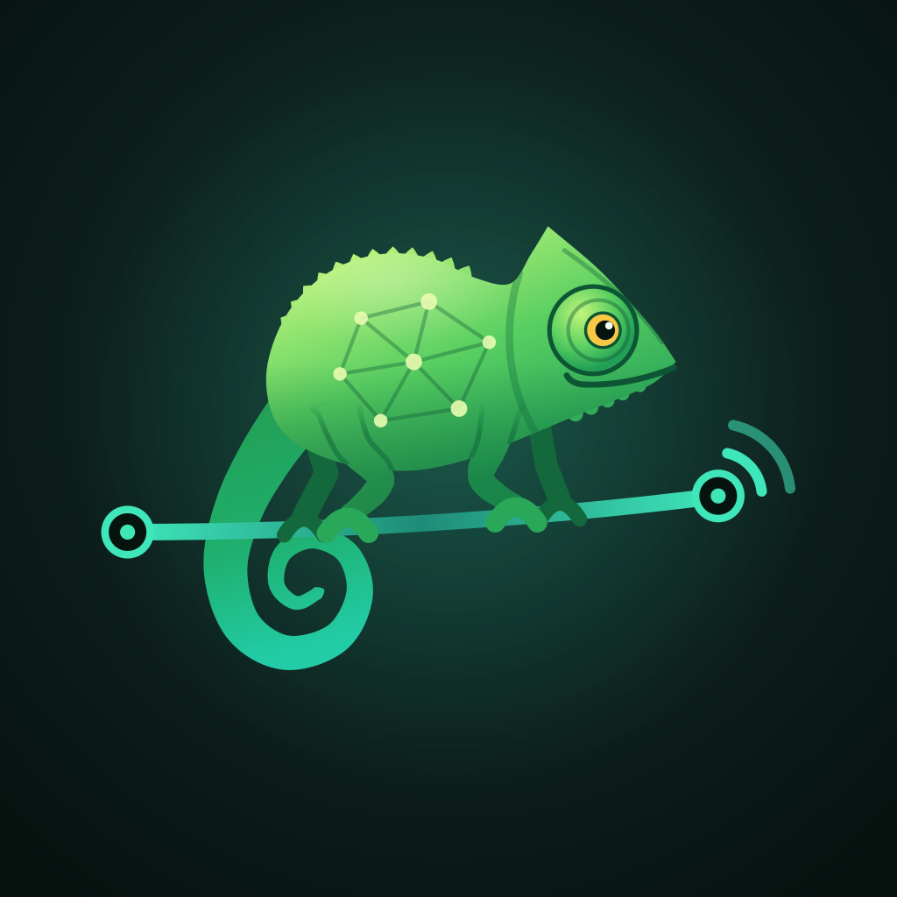
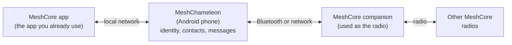

  

# MeshChameleon

**A MeshCore companion that lives on your phone.**

MeshCore is a long-range radio messaging system that works without cell service
or an internet connection. Most MeshCore apps expect a **companion**: a small
radio that holds your identity and handles sending and receiving messages.

MeshChameleon is an open-source Android app that flips that around. It takes
over the companion role and uses an ordinary MeshCore radio as a simple radio
link. Like its namesake, it blends in: to your MeshCore app, it looks and
behaves like a normal companion.

It is not a messaging app: you still use your MeshCore app to read and send
messages.

## Why use it?

- **Your identity stays with you.** Your MeshCore name, key, contacts, channels,
  and message queue live on the phone. You can replace or reconnect the radio
  without losing them.
- **Use the radio you already have.** Keep your existing MeshCore companion;
  MeshChameleon uses it as the radio.
- **Keep more than one identity.** Run several MeshCore identities at once and
  switch which one your app sees, without needing a separate radio for each.
  They all keep receiving while connected.
- **Keep using your MeshCore app.** Point your existing client at MeshChameleon
  over the local network and carry on as usual.
- **Leave it running.** MeshChameleon is designed to keep the link alive while
  you use other apps, and can reconnect on launch.

## What you can do

With MeshChameleon connected, your MeshCore app can do the things it normally
does through a companion:

- send and receive direct messages
- join channels and exchange group messages
- manage contacts and announce yourself to the mesh
- request status and sensor telemetry where the mesh supports it
- see radio battery and storage information
- switch between identities without touching the radio
- reconnect on launch, if **Resume on launch** is enabled

## Using more than one identity

Each identity has its own name, key, contacts, channels, and message queue. While
a device is connected, **all identities keep receiving**, so messages still
arrive for the ones you are not currently using. The **active** identity is the
one your MeshCore app sees; tap another identity to switch, and the MeshCore app
reconnects to that identity.

You can create extra identities from the identity screen. **Clear local data**
keeps the identity and its name but resets its contacts, channels, and messages.
**Delete** removes an identity permanently and is only available for inactive
identities, not the last remaining one.

## How it works

1. MeshChameleon connects to a normal MeshCore companion over Bluetooth or your
   local network.
2. It keeps your identity, contacts, channels, and queued messages on the phone.
3. It offers a local connection that your MeshCore app can use.
4. Your app talks to MeshChameleon exactly as it would talk to a companion.
5. MeshChameleon uses the connected radio to send and receive over the mesh.

The important part: **your phone owns the identity, not the radio.**

## What you need

- An Android phone. iOS is not supported yet.
- A MeshCore companion radio with its normal firmware, reachable over Bluetooth
  or Wi-Fi/Ethernet.
- A MeshCore client app that can use a **network companion** (a companion
  reached over Wi-Fi or Ethernet instead of Bluetooth). For example,
  [`meshcore-open`](https://github.com/zjs81/meshcore-open).
- The MeshCore app must be able to reach the phone over a trusted local network.
- Preferably, permission for MeshChameleon to run without Android battery
  optimization.

## Getting started

MeshChameleon is an early 0.1.0 project and is not in an app store yet. For now,
install it by building the Android app from source; the linked instructions
cover the required tools. See
[Building the app](DEVELOPMENT.md#building-the-app).

1. Open MeshChameleon. On first launch it creates a default identity named
   `MeshChameleon`.
2. Tap **Device link** and connect your companion. Use **Bluetooth** for a
   nearby radio, or **Network** for a radio on Wi-Fi or Ethernet.
3. Turn on **Proxy server**. It listens on port `5000` by default; you can
   change the port before starting it.
4. In your MeshCore app, add a network companion using your phone's local IP
   address (shown in Android's Wi-Fi settings) and the same port.
5. Optional: turn on **Resume on launch** and exempt MeshChameleon from battery
   optimization so the connection survives normal use.
6. Optional: open the identity card and tap **Create identity** to add another
   identity. Tap an identity to make it active.

## Good to know

- **Use a trusted network.** The local connection has no password or encryption.
  Anyone who can reach it can use your MeshChameleon session and the radio
  settings it exposes.
- **Use one MeshCore app at a time.** MeshChameleon needs exclusive use of the
  radio. Do not run another configuration client against the same companion
  during a session.
- **The phone must stay running.** The service is designed to survive
  backgrounding, but battery optimizations and Doze can still interrupt it.
- **All identities share one radio.** Frequency, transmit power, and other radio
  settings are shared; names, contacts, channels, and messages are separate.
- **The radio's own identity is separate.** MeshChameleon does not use or expose
  the companion's built-in MeshCore identity, and messages sent to that identity
  do not reach the virtual identities.
- **It is not a repeater.** MeshChameleon is a companion; it does not relay other
  people's traffic or extend the mesh's range by itself.

## Project status

Version **0.1.0** is the initial release baseline. The main features are
implemented and pass automated tests, but this is still an early project:

- Android only; iOS is deferred.
- There is no app-store release yet.
- Real-hardware testing is still in progress for Bluetooth, network links, radio
  behavior, and Android background survival.
- Hardware compatibility should be verified on your own radio and phone before
  relying on it.

## Privacy and security

- MeshCore identity keys are stored in Android's secure storage.
- There is no analytics, cloud service, or telemetry upload.
- Contacts, channels, and message history live in the app's private storage.
  They are protected by Android's app sandbox but are not separately encrypted
  at rest.
- The local connection is not encrypted and has no password. Keep it on a
  trusted network.

See [`SECURITY.md`](SECURITY.md) for the full security model and its caveats.

## Technical details

- [`DEVELOPMENT.md`](DEVELOPMENT.md) — architecture, repository layout, build
  and test instructions, protocol notes, compatibility, and known limitations.
- [`SECURITY.md`](SECURITY.md) — identity storage, threat model, and endpoint
  exposure.
- [`app/integration_test/README.md`](app/integration_test/README.md) — opt-in
  hardware-in-the-loop tests and their required configuration.
- [`ATTRIBUTION.md`](ATTRIBUTION.md) — third-party code and licenses.

## License

MIT. See [`LICENSE`](LICENSE).
