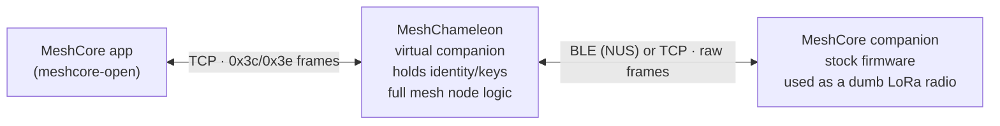

# MeshChameleon

A mobile app that sits between an existing **MeshCore client app** (e.g.
`meshcore-open`) and an existing **MeshCore companion device**. Like its namesake,
it blends in: to the client it *is* the companion, while the identity it serves
lives on the phone and the stock companion device is reduced to a raw radio.



MeshChameleon exposes a **TCP server** that speaks the MeshCore companion protocol
(the same wire format the app uses for a WiFi companion). It generates, stores,
and uses its own Ed25519 MeshCore identity on the phone and reports that identity
in `SELF_INFO`/adverts. Behind the scenes it connects to a real companion device
over **BLE (NUS)** or **TCP**, treating that device as a **raw radio**: it
transmits arbitrary MeshCore packets with `CMD_SEND_RAW_PACKET` and receives
every over-air frame via `PUSH_CODE_LOG_RX_DATA`.

This repository is a standalone reimplementation. It reuses/ports MIT-licensed
code from [`meshcore-open`](https://github.com/zjs81/meshcore-open) (framing,
protocol constants, crypto stack) and
[`openhop_core`](https://github.com/openhop-dev/openhop_core) (companion node
logic). See `ATTRIBUTION.md`.

## Status

Milestones **M0–M4 are complete**: background execution (foreground service,
main-isolate sockets + BLE, battery-optimization exemption prompt,
resume-on-launch), app skeleton and device link, companion-server MVP,
messaging/contacts/channels, and robustness/passthrough (telemetry, trace, radio
tuning passthrough, stats, reconnect/backoff). **M5 (polish + release) is in
progress.**

The pure-Dart core is fully unit-testable without hardware via the included
device simulator. BLE device links and on-air messaging have been validated
against real hardware; telemetry/trace/tuning and the M4 additions have not yet
been validated on hardware. See `PROGRESS.md` for details.

Identity storage and the threat model are described in `SECURITY.md`.

## Repository layout

```
packages/
  mesh_protocol/    On-air packet codec + crypto + identity + shared models
  companion_server/ TCP listener + serial framing + CMD_* router (app-facing)
  mesh_node/        MeshNode: contacts/channels/messages/adverts/acks/...
  device_link/      RadioLink SPI + TCP device client + device simulator
app/                Flutter app: UI, foreground service, secure storage
```

## Development

Prerequisites: Flutter (stable) or a standalone Dart SDK for the pure-Dart
packages.

```sh
# Pure-Dart packages
cd packages/mesh_protocol && dart pub get && dart test
cd packages/companion_server && dart pub get && dart test
cd packages/mesh_node && dart pub get && dart test
cd packages/device_link && dart pub get && dart test

# Flutter app
cd app && flutter pub get && flutter analyze && flutter test
```

## License

MIT. See `LICENSE`.
