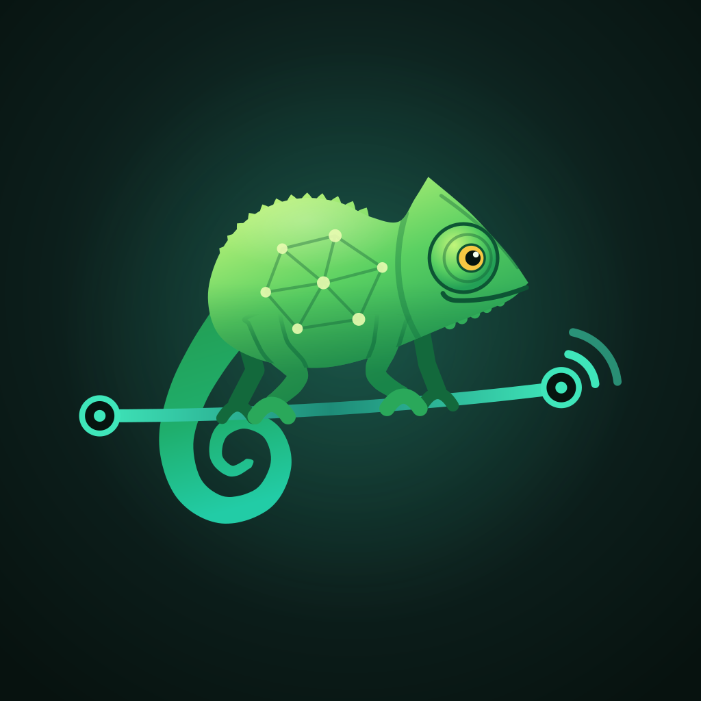
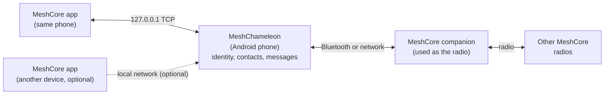

# MeshChameleon

 

**A MeshCore companion that lives on your phone.**

MeshCore is a long-range radio messaging system that works without cell service
or an internet connection. Most MeshCore apps expect a **companion**: a small
radio that holds your identity and handles sending and receiving messages.

MeshChameleon is an open-source Android app that flips that around. It takes
over the companion role and uses an ordinary MeshCore radio as a simple radio
link. Like its namesake, it blends in: to your MeshCore app, it looks and
behaves like a normal companion.

Because your identity lives on the phone, it moves with you. Keep a high-gain
companion with a roof antenna at home and a portable node for when you are out:
connect whichever radio is nearby and MeshChameleon serves the same identity,
contacts, channels, and message history from the phone. Switching radios
requires no key export, import, or identity change.

MeshChameleon and your MeshCore app normally run on the same phone. The app
connects to MeshChameleon at `127.0.0.1`, port `5000` by default, so no local
network is involved. You can also let a MeshCore app on another device connect
over your local network.

It is not a messaging app: you still use your MeshCore app to read and send
messages.

**New here?** The [User Guide](docs/USER_GUIDE.md) walks through setup,
screens, identities, and troubleshooting with dark-mode screenshots.

## Why use it?

- **Your identity stays with you.** Your MeshCore name, key, contacts, channels,
  and message queue live on the phone. Use the same identity with a home radio,
  a portable node, or any other companion you connect.
- **Use the radios you already have.** Keep your existing MeshCore companions;
  MeshChameleon uses whichever one is connected as the radio.
- **Keep more than one identity.** Run several MeshCore identities at once and
  switch which one your app sees, without needing a separate radio for each.
  They all keep receiving while connected.
- **Keep using your MeshCore app.** Run it on the same phone and point it at
  MeshChameleon on `127.0.0.1`; a client on another device can use your local
  network instead.
- **Leave it running.** MeshChameleon is designed to keep the link alive while
  you use other apps. A short drop reconnects transparently; a longer outage
  parks the proxy and waits for the radio without closing the app.

## What you can do

With MeshChameleon connected, your MeshCore app can do the things it normally
does through a companion:

- send and receive direct messages
- join channels and exchange group messages
- manage contacts and announce yourself to the mesh
- request status and sensor telemetry where the mesh supports it
- share the phone's battery percentage and optional GPS with permitted contacts
- see radio battery and storage information
- switch between identities without touching the radio
- use the same identity with a home radio or a portable node
- back up and restore identities, contacts, channels, messages, and settings in
  one encrypted file
- reconnect on launch, if **Resume on launch** is enabled, and recover a dropped
  session while running even when it is off
- check the installed version and live link statistics in
  **Information**

## Using more than one identity

Each identity has its own name, key, contacts, channels, and message queue. While
a device is connected, **all enabled identities keep receiving**, so messages
still arrive for the ones you are not currently using. The **active** identity is
the one your MeshCore app sees; tap another identity to switch, and the MeshCore
app reconnects to that identity.

You can create extra identities from the identity screen. Disable an identity to
stop it from running and receiving while keeping its key, contacts, channels, and
queue for later; re-enable it whenever you want. **Clear local data** keeps the
identity and its name but resets its contacts, channels, and messages. **Delete**
removes an identity permanently and is only available for inactive identities,
not the last remaining one. The active identity must stay enabled; activate
another identity first if you want to disable it.

## How it works

1. MeshChameleon connects to a normal MeshCore companion over Bluetooth or
   Wi-Fi/Ethernet.
2. It keeps your identity, contacts, channels, and queued messages on the phone.
3. It serves a TCP companion endpoint on the phone, port `5000` by default.
4. Your MeshCore app, normally on the same phone, connects to `127.0.0.1` and
   talks to MeshChameleon exactly as it would talk to a companion.
5. MeshChameleon uses the connected radio to send and receive over the mesh.
6. Connect a different radio whenever you want; the identity stays on the phone.

The important part: **your phone owns the identity, not the radio.**

## What you need

- An Android phone running Android 7.0 (API 24) or newer. iOS is not supported
  yet.
- A MeshCore companion radio with its normal firmware, reachable over Bluetooth
  or Wi-Fi/Ethernet. You can switch between radios at any time.
- A MeshCore client app that can use a **TCP/network companion** — for example
  the official MeshCore app,
  [`MeshCore Open`](https://github.com/zjs81/meshcore-open), or another
  TCP-capable client. It normally runs on the same phone as MeshChameleon.
- No local network is needed when the client runs on the same phone. If it runs
  on another device, both must be on the same trusted local network.
- For reliable background operation, set MeshChameleon to **Unrestricted** in
  Android's battery settings. The home-screen **Battery optimization** card
  opens the right screen.

## Getting started

MeshChameleon is an early prerelease and is not in an app store yet. Signed
test builds are published on
[GitHub Releases](https://github.com/jhuebert/MeshChameleon/releases): download
the `MeshChameleon-<version>-universal.apk` and install it. Release APKs are
signed with the app signing key; the fingerprints are listed in
[DEVELOPMENT.md](DEVELOPMENT.md#release-signing). To build it
yourself, see [Building the app](DEVELOPMENT.md#building-the-app). For
step-by-step help with screenshots, use the
[User Guide](docs/USER_GUIDE.md).

Short version:

1. Open MeshChameleon. On first launch it creates a default identity named
   `MeshChameleon`.
2. Tap **Device link** and connect your companion. Use **Bluetooth** for a
   nearby radio, or **Network** for a radio on Wi-Fi or Ethernet.
3. Turn on **Proxy server**. It listens on port `5000` by default; you can
   change the port before starting it.
4. In your MeshCore app on the same phone, add a **TCP** or **network**
   companion at `127.0.0.1` (or `localhost`) and the same port. If the client is
   on another device, use the phone's local IP address instead.
5. Optional: turn on **Resume on launch**. For reliable background operation,
   open the **Battery optimization** card and set MeshChameleon to
   **Unrestricted** in Android's battery settings.
6. Optional: open the identity card and tap **Create identity** to add another
   identity. Tap an identity to make it active.
7. To use a different radio, disconnect the current one and connect the other.
   Your identity and data stay on the phone.

## Good to know

- **Use a trusted phone and network.** The TCP endpoint has no password or
  encryption. Any app on the phone can reach it, and devices on your local
  network can too. Do not expose it to the internet.
- **Switch radios freely.** Disconnect one companion and connect another. The
  identity, contacts, channels, and messages stay on the phone; only the radio
  link changes.
- **Use one MeshCore app at a time.** MeshChameleon needs exclusive use of the
  radio. Do not run another configuration client against the same companion
  during a session.
- **The phone must stay running.** The service is designed to survive
  backgrounding, but battery optimizations and Doze can still interrupt it. If
  the radio is away for long, the notification changes to **Waiting for
  companion**; tap **Cancel** to stop waiting. A parked recovery re-arms when
  you reopen the app after a process kill.
- **All identities share the connected radio.** Frequency, transmit power, and
  other radio settings are shared; names, contacts, channels, and messages are
  separate.
- **The radio's own identity is separate.** MeshChameleon does not use or expose
  the companion's built-in MeshCore identity, and messages sent to that identity
  do not reach the virtual identities. The identity your MeshCore app sees is the
  one on the phone, so it stays the same when you switch radios.
- **It is not a repeater.** MeshChameleon is a companion; it does not relay other
  people's traffic or extend the mesh's range by itself.

## Project status

The storage baseline is **0.1.0**; the first signed public build is the
**0.2.0** pre-release. The main features are implemented and pass automated
tests, but this is still an early project:

- Android only; iOS is deferred.
- There is no Play Store release yet; signed pre-release APKs are on GitHub
  Releases.
- Testers should install the release APKs, not debug builds. Debug builds use a
  machine-local certificate and cannot update to release or Play builds.
- Real-hardware testing is still in progress for Bluetooth, network links, radio
  behavior, and Android background survival.
- Hardware compatibility should be verified on your own radio and phone before
  relying on it.

## Privacy and security

- MeshCore identity keys are stored in Android's secure storage.
- There is no analytics, cloud service, or telemetry upload. Connection
  statistics are session-only and stay in memory; copying diagnostics is an
  explicit local action.
- Contacts, channels, and message history live in the app's private storage.
  They are protected by Android's app sandbox but are not separately encrypted
  at rest.
- The TCP endpoint is not encrypted and has no password. Any app on the phone
  can reach it, and devices on your local network can too. Keep it on a trusted
  phone and network, and do not expose it to the internet.
- Backup files you create contain identity private keys. They are encrypted
  with your passphrase; keep the file and passphrase as safe as the keys.

See [`SECURITY.md`](SECURITY.md) for the full security model and its caveats.

## Documentation

- [`docs/USER_GUIDE.md`](docs/USER_GUIDE.md) — complete setup and usage guide
  with screenshots, identity management, background tips, and troubleshooting.
- [`DEVELOPMENT.md`](DEVELOPMENT.md) — architecture, repository layout, build
  and test instructions, protocol notes, compatibility, and known limitations.
- [`SECURITY.md`](SECURITY.md) — identity storage, threat model, and endpoint
  exposure.
- [`app/integration_test/README.md`](app/integration_test/README.md) — opt-in
  hardware-in-the-loop tests and their required configuration.
- [`ATTRIBUTION.md`](ATTRIBUTION.md) — third-party code and licenses.

## License

MIT. See [`LICENSE`](LICENSE).
