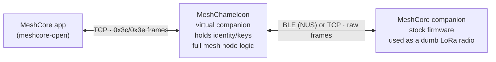

# MeshChameleon

A mobile app that sits between an existing **MeshCore client app** (e.g.
`meshcore-open`) and an existing **MeshCore companion device**. Like its namesake,
it blends in: to the client it *is* the companion, while the identity it serves
lives on the phone and the stock companion device is reduced to a raw radio.



MeshChameleon exposes a **TCP server** that speaks the MeshCore companion protocol
(the same wire format the app uses for a WiFi companion). It generates, stores,
and uses its own Ed25519 MeshCore identity on the phone and reports that identity
in `SELF_INFO`/adverts. Behind the scenes it connects to a real companion device
over **BLE (NUS)** or **TCP**, treating that device as a **raw radio**: it
transmits arbitrary MeshCore packets with `CMD_SEND_RAW_PACKET` and receives
every over-air frame via `PUSH_CODE_LOG_RX_DATA`.

This repository is a standalone reimplementation. It reuses/ports MIT-licensed
code from [`meshcore-open`](https://github.com/zjs81/meshcore-open) (framing,
protocol constants, crypto stack) and
[`openhop_core`](https://github.com/openhop-dev/openhop_core) (companion node
logic). See `ATTRIBUTION.md`.

## Status

Milestones **M0–M4 are complete** and the **MeshCore 1.18 virtual-companion
handoff (T01–T16) is implemented**: strict 176-byte framing, virtual
identity/capabilities/state, contacts/channels/adverts, persistence and quota,
battery/storage, key import/export, allowlisted CLI, lifecycle, app-only reset,
remote CLI, telemetry and raw endpoints. **Multi-identity management is also
implemented:** several virtual identities stay live on one shared radio while
the selected identity is served to the MeshCore app. **M5 (polish + release)
remains in progress.**

The pure-Dart core is fully unit-testable without hardware via the included
device simulator. The conformance suite drives a real TCP session against the
proxy and a peer node on a simulated radio bus. The 1.18 additions are
simulator/byte-level validated; the hardware matrix (BLE/TCP, RF, WiFi, repeat,
background survival, remote CLI, sensor telemetry) remains **pending** and is
not inferred from a green test suite. See `PROGRESS.md` and `DEVELOPMENT.md`.

Identity storage and the threat model are described in `SECURITY.md`.

## Multi-identity

A fresh install creates and activates one identity named `MeshChameleon`.
Additional identities are created inactive with the wizard; tapping one makes
it the **active** identity served over the companion TCP endpoint. The MeshCore
app reconnects and syncs that identity's contacts, channels, and queued messages.

- **Every identity is live while a device is connected.** Each has its own key,
  contacts, channels, preferences, advert paths, and 512-message drop-oldest
  queue. Inactive identities still receive, decrypt, ACK, and queue traffic
  addressed to them, but never send unsolicited adverts.
- **One physical radio.** Frequency, bandwidth, spreading factor, coding rate,
  TX power, tuning, and client-repeat are shared. Name, location, path-hash mode,
  flood scope, telemetry, auto-add, contacts, and channels are per identity.
- **Every outbound packet is RF-sent and mirrored** in-process to the other live
  identities, so local delivery does not depend on the radio echoing its own
  transmission. The RF copy still consumes airtime.
- **Queued counts** on the identity cards are messages waiting for the MeshCore
  app to sync; MeshChameleon does not know the app's read state.
- **Clear local data** keeps the identity key and current name. Deleting an
  identity requires it to be inactive and is unavailable for the last identity.
- **Naming belongs to the MeshCore app** after creation. Key import/export is
  available only through the companion protocol for the active identity; the
  MeshChameleon UI has no key reveal/import/regenerate controls.
- **The attached radio's own companion identity cannot be messaged** through the
  virtual stack, because the same radio transmits the packet and never receives
  its own raw TX. Unicasts to that key are rejected. A *different* physical
  companion works normally over RF.

There is no migration from the pre-multi-identity single-key/single-state layout;
development data from those builds is intentionally ignored. Storage uses
`<app-support>/identities/index.json`, per-identity
`<app-support>/identities/<id>/node_state.json`, and per-identity secure-storage
slots. The identity database is never silently replaced; a corrupt catalog shows
a recovery screen with retry.

## Connecting a device

The **Connect device** screen shows one tab per available transport: Bluetooth
when the platform supports BLE, Network always, and Simulated only in
development builds. The tab bar is hidden when only Network is available.
Successful TCP `host:port` targets are saved newest-first (maximum 20) in
`<app-support>/network_connections.json`; tap a saved card to reconnect, or use
delete with Undo. Failed attempts are never saved, and BLE or simulated sessions
do not create network history entries.

## Compatibility notes

The advertised virtual `DEVICE_INFO` baseline is firmware code **14** /
**`v1.18.0`**, with the virtual board, 350-contact/40-channel capacities, a
4 MiB virtual storage partition, and the physical radio's repeat byte and real
max TX/RF values. Intentional differences from bare firmware are documented in
`DEVELOPMENT.md`: no automatic physical state writes, saved-vs-active radio
settings, a host-derived virtual clock, a minimal virtual sensor subset, blocked
PIN/factory reset, remote physical administration denial, and honest persistence
errors. The app-facing TCP endpoint is **plaintext and unauthenticated**; keep it
on trusted networks.

## Repository layout

```
packages/
  mesh_protocol/    On-air packet codec + crypto + identity + shared models
  companion_server/ TCP listener + serial framing + CMD_* router (app-facing)
  mesh_node/        MeshNode: contacts/channels/messages/adverts/acks/...
  device_link/      RadioLink SPI + TCP device client + device simulator
app/                Flutter app: UI, foreground service, secure storage
```

## Development

Prerequisites: Flutter (stable) or a standalone Dart SDK for the pure-Dart
packages.

```sh
# Pure-Dart packages
cd packages/mesh_protocol && dart pub get && dart test
cd packages/companion_server && dart pub get && dart test
cd packages/mesh_node && dart pub get && dart test
cd packages/device_link && dart pub get && dart test

# Flutter app
cd app && flutter pub get && flutter analyze && flutter test
```

## License

MIT. See `LICENSE`.
