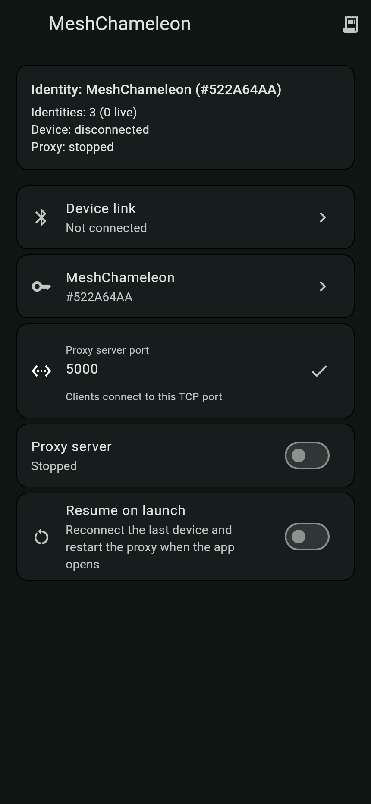
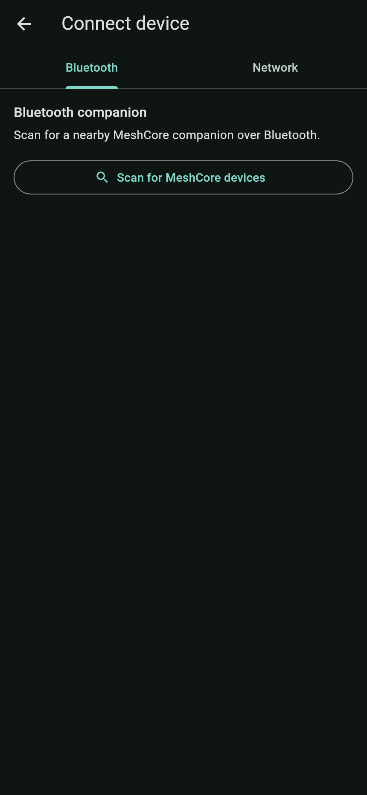
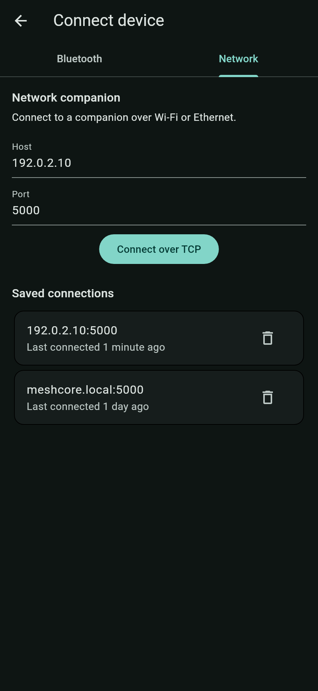
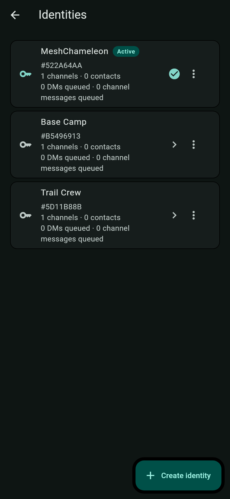
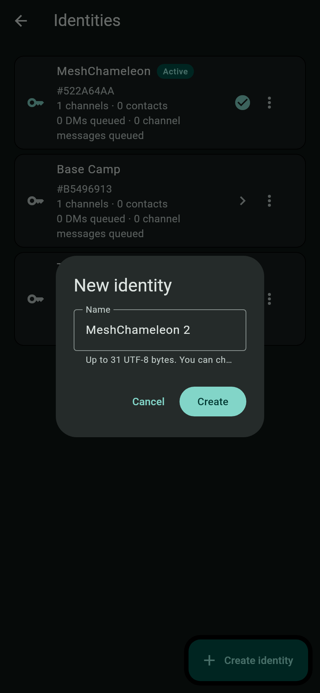
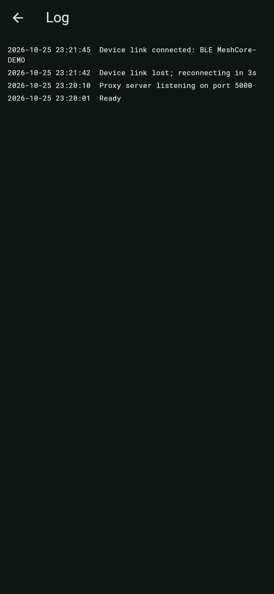

# MeshChameleon User Guide

Version 0.1.0 · Android

MeshChameleon makes an Android phone act as a MeshCore companion while using an
ordinary MeshCore radio for the actual sending and receiving. You keep using
your normal MeshCore app; MeshChameleon is the companion behind it.

This guide covers installation, connecting a radio, starting the proxy, managing
identities, background operation, backups, and troubleshooting.

> Screenshots show the app in dark mode with sample identities. The Android build
> also has a **Battery optimization** card on the home screen, described below.

## Contents

- [What you need](#what-you-need)
- [Install MeshChameleon](#install-meshchameleon)
- [The home screen](#the-home-screen)
- [Connect a radio](#connect-a-radio)
- [Start the proxy and connect your MeshCore app](#start-the-proxy-and-connect-your-meshcore-app)
- [Manage identities](#manage-identities)
- [Everyday use](#everyday-use)
- [Background operation and battery](#background-operation-and-battery)
- [Logs and troubleshooting](#logs-and-troubleshooting)
- [Privacy and security](#privacy-and-security)
- [Backups, updates, and uninstalling](#backups-updates-and-uninstalling)
- [Limits and compatibility](#limits-and-compatibility)
- [FAQ](#faq)
- [Glossary](#glossary)
- [More documentation](#more-documentation)

## What you need

- An Android phone running Android 7.0 or newer. iOS is not supported yet.
- A normal MeshCore companion radio, reachable over Bluetooth or Wi-Fi/Ethernet.
  For a network-connected radio, the phone and radio must be on the same network.
- A MeshCore client app that can connect to a **network** or **Wi-Fi/TCP**
  companion. MeshChameleon does not expose a Bluetooth companion to the client
  app; the client always connects over the network.
- The client app and the phone on the same trusted local network.
- Bluetooth and notification permissions granted when Android asks.
- For reliable background operation, permission for MeshChameleon to ignore
  Android battery optimization.

You do **not** need an internet connection. You do need the phone and the
MeshCore app to be able to reach each other on your local network.

> MeshChameleon is not a messaging app and not a radio. It replaces neither your
> MeshCore app nor your MeshCore companion.

## Install MeshChameleon

MeshChameleon is an early project and is not in an app store yet. Install it by
building the Android app from source:

- [Building the app](../DEVELOPMENT.md#building-the-app)
- [Development setup and prerequisites](../DEVELOPMENT.md)

After installing, open **MeshChameleon**. On first launch it creates a default
identity named `MeshChameleon`.

## The home screen

  

The home screen is the control panel for the whole app.

| Card | What it does |
|---|---|
| **Status** | Shows the active identity, how many identities exist and are live, whether a device is connected, and whether the proxy is running. |
| **Device link** | Opens the connection screen. When connected, it shows the device name and a **Disconnect** button. |
| **Identity card** | Opens the identities screen. The title is the active identity's name. |
| **Proxy server port** | Shows the local port your MeshCore app will connect to. It can only be edited while the proxy is stopped. |
| **Proxy server** | Starts or stops the local companion server. The proxy needs a connected device and an available identity. |
| **Resume on launch** | Reconnects the last device and restarts the proxy when you open the app. |
| **Battery optimization** (Android only) | Shows whether Android is throttling the app. Tap **Disable** to request an exemption. |

The receipt icon in the top-right corner opens the **Log** screen. Check it when
something does not work as expected.

### Status card

The status card is a quick health check:

- **Identity** — the name and public-key prefix of the identity your MeshCore
  app is currently using.
- **Identities** — total identities and how many are **live**. A live identity
  is running and receiving; this requires a connected device.
- **Device** — `connected` or `disconnected`.
- **Proxy** — `stopped` or `running (port 5000)`.
- **Radio battery** — on Android, a fresh/stale battery sample appears when a
  device is connected.

## Connect a radio

Tap **Device link** on the home screen. Choose **Bluetooth** for a nearby radio
or **Network** for a radio on Wi-Fi or Ethernet.

Development builds may also show a **Simulated** tab. It runs entirely in memory
and is only for testing without radio hardware. Do not use it for normal
operation.

### Bluetooth

  

1. Power on the MeshCore companion and keep it nearby.
2. Make sure no other phone or app is connected to the companion. A companion
   normally accepts one connection at a time.
3. On the **Bluetooth** tab, tap **Scan for MeshCore devices**.
4. Grant the **Nearby devices** permission if Android asks.
5. Wait for the radio to appear. Its advertised MeshCore name and signal
   strength are shown.
6. Tap the radio to connect.

When the connection succeeds, you return to the home screen and **Device link**
shows the connected radio. If it fails, open the **Log** screen for details.

If the scan finds nothing:

- Confirm the radio is powered on and advertising as a MeshCore companion.
- Close any MeshCore app that may already be connected to the radio.
- Move the phone closer, turn Bluetooth off and on, then scan again.
- Try restarting the radio.

### Network

  

1. Put the companion on the same network as the phone, in its Wi-Fi or network
   companion mode. Note the radio's IP address.
2. On the **Network** tab, enter the radio's **Host** and **Port**.
3. Tap **Connect over TCP**.

The host and port here are the **radio's** address and port, not the port your
MeshCore app will use later.

Successful network connections are saved under **Saved connections**:

- Tap a saved card to reconnect.
- Tap the trash icon to remove it. A snackbar offers **Undo**.
- Up to 20 recent targets are kept, newest first.
- Failed attempts are not saved.

If the connection fails:

- Confirm the radio's network address and port.
- Confirm the phone and radio are on the same network.
- Check the **Log** screen; common causes include a wrong port, a radio that is
  not in network mode, or another client already using the radio.

### While connected

When a device link is active:

- The home screen shows **Device: connected**.
- Every identity in the catalog starts running; the status card shows how many
  are live.
- Android shows an ongoing **MeshChameleon** notification. Keep it visible;
  it is what keeps the link alive when you switch apps.
- The radio's own MeshCore identity is not used or exposed by MeshChameleon.

### Disconnect and reconnect

Tap **Disconnect** on the home screen or on the connection screen. This also
stops the proxy.

If the link drops unexpectedly, MeshChameleon retries automatically. If the
radio was rebooted, wait for it to come back. If the radio was powered off
through a MeshCore command, automatic reconnecting is suppressed until you
connect again yourself.

### Which connection should I use?

- **Bluetooth** is simplest for a nearby radio and does not need a network.
- **Network** is useful when the radio is farther away or already on Wi-Fi or
  Ethernet.

Either way, the MeshCore app still connects to the phone over the local network.

## Start the proxy and connect your MeshCore app

The proxy is the local connection your MeshCore app uses. It only runs after a
radio is connected.

1. Connect the radio first.
2. On the home screen, set **Proxy server port** if you do not want the default
   `5000`. The port can only be changed while the proxy is stopped.
3. Turn on **Proxy server**. The card should say **Listening on port 5000** (or
   the port you chose).
4. Find the phone's local Wi-Fi IP address in Android's Wi-Fi settings.
5. In your MeshCore app, add or connect to a **network**, **Wi-Fi**, or **TCP**
   companion using that phone IP and the proxy port.
6. The MeshCore app should connect and show the active MeshChameleon identity.

If the proxy will not stay on:

- Make sure a radio is connected.
- Make sure the active identity is available and not showing a key error.
- Make sure the port is not already used by another app. Stop the proxy, choose
  another port, save it, and start again.
- Check the **Log** screen for the exact error.

If the MeshCore app cannot connect:

- Confirm the proxy says **Listening**.
- Confirm the client is using the phone's local network IP, not a cellular IP.
- Confirm both devices are on the same network and that client isolation, a VPN,
  or a firewall is not blocking the port.
- Confirm the port in the client matches the port in MeshChameleon.
- Remember that the connection has no password or encryption. Use it only on a
  trusted network.

To stop serving clients, turn off **Proxy server** or disconnect the device.

## Manage identities

An identity is a MeshCore persona: its name, key, contacts, channels, and
message queue. MeshChameleon can keep several identities on one phone and serve
one of them to your MeshCore app at a time.

  

Open the identities screen by tapping the identity card on the home screen.

### Create an identity

  

1. Tap **Create identity**.
2. Enter a name. The limit is 31 UTF-8 bytes.
3. Tap **Create**.

The new identity is created **inactive**. It starts running immediately, but it
is not the one your MeshCore app sees until you activate it.

After creation, naming is controlled by your MeshCore app. Changing the name
there updates the identity's stored name.

### Switch the active identity

Tap an inactive identity in the list. MeshChameleon makes it active, closes the
current client connection, and serves the new identity. Your MeshCore app
reconnects and sees the new identity.

The currently active identity is marked **Active**. Tapping it again does
nothing.

### Active vs. live

- **Active** — the identity your MeshCore app is currently connected to.
- **Live** — the identity is running and receiving while a device is connected.

All identities are live while a device is connected. Inactive identities still
receive, decrypt, acknowledge, and queue messages addressed to them. They just
do not send adverts on their own, and your MeshCore app does not see them until
you switch.

### Queued messages

The identity cards show how many direct and channel messages are waiting. A
message stays queued until your MeshCore app syncs it. MeshChameleon does not
know what the app has already read.

If messages show as queued but do not appear in the client:

- Make sure the client is connected to the right identity.
- Use the client's message sync function.
- Check the **Log** screen for transport errors.

### Clear local data

Open the three-dot menu on an identity and choose **Clear local data**.

This keeps the identity key and its current name, but removes its contacts,
channels, queued messages, advert paths, and preferences. If the identity is
active, the MeshCore app reconnects.

### Delete an identity

Open the three-dot menu and choose **Delete identity**.

- You can only delete an inactive identity.
- The last remaining identity cannot be deleted.
- Deletion is permanent.

To delete the active identity, first activate another one.

### If a key is unavailable

If an identity shows a key error, it cannot be activated. The key may be missing
from Android's secure storage. You can delete the identity if another one
remains, but you cannot recover the missing key from MeshChameleon.

## Everyday use

MeshChameleon has no chat interface of its own. Use your MeshCore app for normal
mesh activity. Through the app, you can:

- send and receive direct messages
- use channels and group messages
- manage contacts and share contact information
- announce your identity to the mesh
- request status and telemetry where supported
- see the radio's battery and the virtual storage usage
- switch identities and let the client reconnect

The exact labels and options come from your MeshCore app; MeshChameleon provides
the companion side. Where the app exposes radio settings or a reboot command,
MeshChameleon forwards them to the radio.

### Common actions

These actions live in your MeshCore app, not in MeshChameleon:

- **Send a direct message** — open the contact and compose a message as usual.
- **Use a channel** — open the channel and send your message there.
- **Add or share a contact** — use the app's contact import, share, or discover
  action.
- **Announce yourself** — use the app's advert or discover action.
- **Sync queued messages** — use the app's message-sync or receive action.
- **Change radio settings** — use the app's radio settings screen. Some changes
  apply after the radio reboots.

All identities share the radio's frequency, transmit power, and other radio
settings. Names, contacts, channels, and message queues are separate.

Some radio changes are saved on the companion and only take effect after the
radio reboots. Your MeshCore app can send the reboot command where supported.

## Background operation and battery

MeshChameleon is designed to keep the radio link and proxy running while you use
other apps.

### The ongoing notification

While a device is connected, Android shows a **MeshChameleon** notification. It
summarizes the identity, device, and proxy state. Keep the notification enabled;
tapping it returns to the app.

### Battery optimization

On Android, the home screen has a **Battery optimization** card:

- **Optimized** — Android may pause the app in the background. Tap **Disable**
  and approve the system prompt.
- **Exempt** — the app can keep the link running in the background.

Some phone manufacturers add their own battery restrictions. If the link keeps
dying when the screen is off, also check the phone manufacturer's battery
settings for MeshChameleon.

### Resume on launch

Turn on **Resume on launch** to reconnect the last device and restart the proxy
the next time you open the app.

This is not a boot service. After a phone reboot, open MeshChameleon once before
relying on the proxy again.

## Logs and troubleshooting

  

Tap the receipt icon in the top-right corner of the home screen. The newest
entries are at the top. The log is the first place to check when a connection,
the proxy, or an identity does not behave as expected.

Logs may contain network addresses and contact information. Review them before
sharing them publicly.

### Bluetooth scan finds nothing

- Confirm the radio is on and advertising as a MeshCore companion.
- Disconnect any other app or phone currently using it.
- Grant the **Nearby devices** permission.
- Toggle Bluetooth and scan again.
- Move closer and restart the radio if necessary.

### Network connection fails

- Confirm the radio's IP address and port.
- Confirm the radio is in Wi-Fi or network companion mode.
- Confirm the phone and radio are on the same network.
- Check for VPNs, firewalls, or client isolation.
- Check the log for a timeout or connection-refused error.

### The proxy switch turns back off

- Connect a radio first.
- Make sure the active identity is available.
- Choose an unused port while the proxy is stopped.
- Check the log; a port-in-use error means another app owns that port.

### The MeshCore app cannot reach the phone

- Confirm the proxy says **Listening**.
- Use the phone's Wi-Fi/LAN address, not a cellular address.
- Confirm both devices are on the same network.
- Confirm the client is configured as a network/Wi-Fi/TCP companion, not
  Bluetooth.
- Confirm the port matches.

### The client connects but shows the wrong identity

Tap the identity you want in the identities screen. The current client is
disconnected and the client reconnects to the newly active identity.

### Messages arrive late or not at all

- Confirm the radio is on the same frequency and channel as the rest of the
  mesh. MeshChameleon does not change the mesh's radio settings by itself.
- Confirm the message is queued on the correct identity.
- Sync messages from the MeshCore app.
- Check the log for link drops or transmission errors.
- Remember that a direct route can take time to become known; flooded traffic
  may also arrive late.

### The link keeps dropping

- Grant the battery-optimization exemption.
- Check the phone manufacturer's background-app restrictions.
- Keep the ongoing notification enabled.
- Check the radio's power and range.
- After a radio reboot, allow time for the automatic reconnect.

### The identity database is unavailable

Retry from the screen that appears. Do not clear app storage or uninstall: that
removes the identity keys. If retrying does not help, seek help before taking any
destructive action.

### I cannot delete an identity

The active identity cannot be deleted, and the last identity cannot be deleted.
Activate a different identity first.

### I cannot message the radio's own identity

This is expected. MeshChameleon does not use or expose the companion radio's
built-in MeshCore identity. Messages sent to that identity do not reach the
virtual identities.

### The app stopped after I powered off the radio

Powering off the radio through a MeshCore command suppresses automatic
reconnection. Open **Device link** and connect again when the radio is back.

## Privacy and security

- Use MeshChameleon only on a trusted local network. The client-facing server
  has no password and no encryption. Anyone who can reach it can use the
  session and the radio controls it exposes.
- Do not expose the proxy port to the internet or forward it through your
  router.
- Identity private keys are stored in Android's secure storage.
- MeshChameleon has no analytics, cloud service, or telemetry upload.
- Contacts, channels, and messages live in app-private files. They are protected
  by Android's app sandbox but are not separately encrypted at rest.
- Use one MeshCore app at a time. The proxy expects exclusive use of the radio.
- Exported private keys are extremely sensitive. Never paste them into a chat,
  issue tracker, or cloud note.

See [`SECURITY.md`](../SECURITY.md) for the full security model.

## Backups, updates, and uninstalling

### Updating

Install a newer build over the existing app. Android keeps app data when the
application ID and signing key match. The 0.1.0 storage baseline is designed to
migrate forward in later releases.

### Backing up an identity

MeshChameleon's UI does not have a backup or key-export button. A connected
MeshCore client that supports the normal companion private-key export command
can export the **active** identity's key. That export contains the key only, not
the identity's contacts, channels, or message history.

Android backup is disabled for MeshChameleon by design. If you uninstall the app
or clear its storage, the identity keys and local state are removed.

### Moving to a new phone

1. Export the active identity's private key with a compatible MeshCore client.
2. Store the key somewhere safe and offline.
3. Install MeshChameleon on the new phone.
4. Import the key into the active identity with the client.
5. Recreate contacts, channels, and other state as needed.

Recreating state is necessary because only the key is exported through the
companion protocol.

### Uninstalling or resetting

- To remove one identity's local data, use **Clear local data** in its menu.
- To remove everything, uninstall MeshChameleon or use Android's **Clear
  storage** for the app.
- Clearing app storage or uninstalling is irreversible unless you exported the
  key first.

## Limits and compatibility

- Android only; iOS is not supported yet.
- No app-store release yet; builds come from source.
- One radio link and one MeshCore client at a time.
- The MeshCore client must support a network/Wi-Fi/TCP companion.
- The radio must be a normal MeshCore companion; MeshChameleon does not replace
  its firmware. USB radio links are not supported.
- MeshChameleon is not a repeater and does not relay other people's traffic.
- The companion radio's own identity is not used or exposed.
- All identities on the phone share one radio's frequency, power, and tuning.
- The virtual companion presents 350 contacts, 40 channels, and 4 MiB of virtual
  storage per identity.
- Hardware validation is still in progress. Test your phone and radio
  combination before depending on it.
- The proxy is plaintext and unauthenticated.
- There is no true boot-time resume; open the app after a reboot.

For protocol and compatibility details, see
[`DEVELOPMENT.md`](../DEVELOPMENT.md#compatibility-target-and-intentional-differences).

## FAQ

**Do I need internet access?**  
No. MeshCore uses radio, and the MeshCore app connects to the phone over your
local network.

**Can I use MeshChameleon from another network?**  
Not safely. The proxy has no password or encryption. Keep it on a trusted local
network.

**Can I use any MeshCore app?**  
Only one that can connect to a network/Wi-Fi/TCP companion. Bluetooth-only
clients cannot connect to MeshChameleon's client endpoint.

**Can two MeshCore apps connect at once?**  
No. Use one client per session; the proxy expects exclusive use of the radio.

**Can I change radios?**  
Yes. Disconnect the current radio and connect another. The identities stay on
the phone.

**Can I use several identities at once?**  
All identities stay live and receive while connected, but only the active
identity is served to your MeshCore app. Tap another identity to switch.

**Why does the client disconnect when I switch identities?**  
Serving a different identity changes the companion's identity. The client is
disconnected and reconnects to the new one.

**Can I run MeshChameleon without a radio?**  
Only the development-only **Simulated** companion does that. It is for testing,
not real mesh traffic.

**Can I use the radio's built-in identity through MeshChameleon?**  
No. The radio is used as a radio, and its own identity is kept separate.

**Why do some radio settings need a reboot?**  
The companion saves some settings and applies them when it restarts. Your
MeshCore app can send a reboot command where supported.

**Why is the app killed in the background?**  
Android battery optimization is the usual cause. Grant the exemption and check
the phone manufacturer's battery settings.

**How do I find the phone's IP address?**  
Open Android's Wi-Fi settings and look at the connected network's details. Use
that address in your MeshCore app.

**What port should I use?**  
The default is `5000`. Use the same port in MeshChameleon and the MeshCore app.

**Is MeshChameleon open source?**  
Yes. It is MIT-licensed; see [`LICENSE`](../LICENSE).

## Glossary

- **MeshCore** — a long-range radio messaging system that works without cell
  service or internet.
- **Companion** — the radio a MeshCore app normally talks to.
- **Client app** — the MeshCore app you use to send messages and manage contacts.
- **Identity** — a MeshCore persona: its name, private key, contacts, channels,
  and message queue.
- **Active identity** — the identity currently served to the MeshCore app.
- **Live identity** — an identity that is running and receiving while a device is
  connected.
- **Proxy** — MeshChameleon's local server that the MeshCore app connects to.
- **Network companion** — a companion reached over Wi-Fi or Ethernet instead of
  Bluetooth.
- **BLE** — Bluetooth Low Energy, used for nearby companion radios.
- **Queue** — messages waiting for the MeshCore app to sync them.
- **Advert** — a MeshCore announcement that lets other nodes discover you.
- **Telemetry** — status or sensor readings requested from another node.

## More documentation

If you need help, open an issue in the
[project issue tracker](https://github.com/jhuebert/MeshChameleon/issues) and
include the app version, Android version, phone and radio models, connection
type, and the relevant log lines with sensitive information removed.

- [README](../README.md) — project overview and quick start
- [Development notes](../DEVELOPMENT.md) — architecture, protocol, building, and
  compatibility
- [Security notes](../SECURITY.md) — storage and threat model
- [Hardware test guide](../app/integration_test/README.md) — opt-in hardware
  validation tests
- [Attribution](../ATTRIBUTION.md) and [license](../LICENSE)
